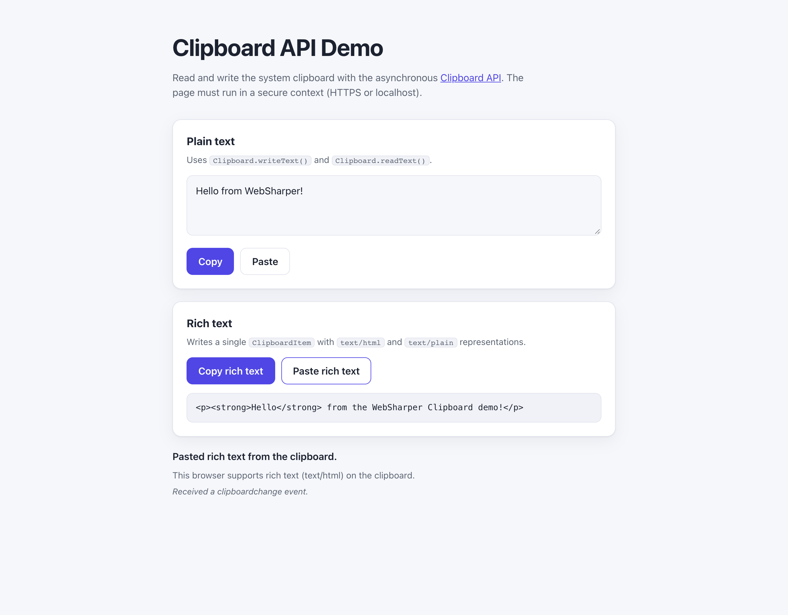

# WebSharper.Clipboard

[](https://github.com/dotnet-websharper/ClipboardAPI)

WebSharper bindings for the [Clipboard API](https://developer.mozilla.org/en-US/docs/Web/API/Clipboard_API) —
asynchronous read and write access to the system clipboard from F# and C# web apps.

The Clipboard API is only available in [secure contexts](https://developer.mozilla.org/en-US/docs/Web/Security/Defenses/Secure_Contexts)
(HTTPS or localhost), and browsers may require a user gesture or a permission prompt before
allowing clipboard access.

This repository contains:

| Project | Purpose |
| --- | --- |
| `WebSharper.Clipboard` | The binding: WIG definitions for `Clipboard`, `ClipboardItem`, `ClipboardEvent`, `ClipboardChangeEvent`, and their option dictionaries. |
| `WebSharper.Clipboard.Extensions` | `[<Inline>]` client extensions: `Navigator.Clipboard`, element `OnCopy`/`OnCut`/`OnPaste` handlers, and `Clipboard.OnClipboardChange`. |
| `WebSharper.Clipboard.Sample` | An ASP.NET Core SPA that demonstrates plain-text and rich-text copy/paste. |

## Live demos

**Try it live:** [Open the sample in your browser](https://dotnet-websharper.github.io/ClipboardAPI/)



The sample doubles as the binding's [test case](#running-the-sample): it exercises plain-text and rich-text copy/paste in a real browser.

- **Sample (this repository):** <https://dotnet-websharper.github.io/ClipboardAPI/>
- **Source repository:** <https://github.com/dotnet-websharper/ClipboardAPI>
- **WebSharper bindings:** <https://websharper.com/bindings>

## Features

- `navigator.clipboard.readText()` / `writeText()` for plain text.
- `navigator.clipboard.read()` / `write()` with `ClipboardItem` for multiple MIME types.
- `ClipboardItem.supports(type)`, `types`, `presentationStyle`, and `getType(type)`.
- `ClipboardEvent` (`clipboardData`) and element `oncopy`/`oncut`/`onpaste` handlers.
- The experimental `clipboardchange` event and `ClipboardChangeEvent` (`types`, `changeId`).

## Installation

The binding is not currently published to NuGet. Reference the projects from source:

```bash
git clone https://github.com/dotnet-websharper/ClipboardAPI.git
```

```xml
<ItemGroup>
  <ProjectReference Include="path/to/WebSharper.Clipboard/WebSharper.Clipboard.fsproj" />
  <ProjectReference Include="path/to/WebSharper.Clipboard.Extensions/WebSharper.Clipboard.Extensions.fsproj" />
</ItemGroup>
```

## Usage

```fsharp
namespace WebSharper.Clipboard.Demo

open WebSharper
open WebSharper.JavaScript
open WebSharper.Clipboard

[<JavaScript>]
module Demo =
    type ClipboardItemData =
        {
            ``text/html``: string
            ``text/plain``: string
        }

    let clipboard = JS.Window.Navigator.Clipboard

    let copyText (text: string) =
        promise {
            try
                do! clipboard.WriteText(text)
                Console.Log("Copied plain text.")
            with ex ->
                Console.Error("Copy failed:", ex.Message)
        }

    let pasteText () =
        promise {
            try
                let! text = clipboard.ReadText()
                Console.Log("Clipboard text:", text)
            with ex ->
                Console.Error("Paste failed:", ex.Message)
        }

    let copyRichText (html: string) (text: string) =
        promise {
            try
                let item = ClipboardItem(box { ``text/html`` = html; ``text/plain`` = text })
                do! clipboard.Write([| item |])
                Console.Log("Copied rich text (text/html + text/plain).")
            with ex ->
                Console.Error("Rich copy failed:", ex.Message)
        }

    let pasteRichText () =
        promise {
            try
                let! items = clipboard.Read()
                if items.Length > 0 then
                    let item = items.[0]
                    if Array.contains "text/html" item.Types then
                        let! blob = item.GetType("text/html")
                        let! html = blob.Text()
                        Console.Log("Clipboard HTML:", html)
            with ex ->
                Console.Error("Rich paste failed:", ex.Message)
        }

    // Experimental: the clipboardchange event is not Baseline.
    clipboard.OnClipboardChange <- fun _ ->
        Console.Log("The clipboard changed.")
```

The binding's `read()` options type is named `ClipboardReadFormats`; set its `Unsanitized`
field to request unsanitized formats. The experimental `clipboardchange` event is available
through `Clipboard.OnClipboardChange` or `addEventListener("clipboardchange", ...)`.

## Running the sample

Build the sample in Release and serve its static output:

```bash
dotnet build WebSharper.Clipboard.Sample/WebSharper.Clipboard.Sample.fsproj -c Release
python3 -m http.server -d WebSharper.Clipboard.Sample/wwwroot 8099
```

Open <http://localhost:8099/>. Localhost counts as a secure context, so the Clipboard API is
available. Grant the clipboard permission when the browser prompts for it.

Alternatively, run the ASP.NET Core host:

```bash
dotnet run --project WebSharper.Clipboard.Sample
```

## Building from source

### Prerequisites

- [.NET SDK 10](https://dotnet.microsoft.com/download) or later.

### Build

```bash
dotnet build WebSharper.Clipboard.sln -c Release
```

The binding projects target `netstandard2.0`; the sample targets `net10.0`.

## Deployment

Pushing to `main` triggers `.github/workflows/ghpages.yml`, which builds the sample in Release
and publishes `WebSharper.Clipboard.Sample/wwwroot` to the `gh-pages` branch.

## Repository layout

```
WebSharper.Clipboard/              # binding (WIG definitions)
  Main.fs
WebSharper.Clipboard.Extensions/   # [<Inline>] client extensions
  Library.fs
WebSharper.Clipboard.Sample/       # ASP.NET Core SPA demo
  Client.fs
  Startup.fs
  wwwroot/
    index.html
    site.css
.github/workflows/ghpages.yml      # build + deploy the sample to GitHub Pages
```

## Notes on the API

- **Secure context:** `navigator.clipboard` is only exposed in secure contexts. Serve the page
  over HTTPS or from localhost.
- **Permissions:** browsers may require a user gesture (for example, a button click) or a
  permission prompt before reading the clipboard. Handle rejected promises.
- **Rich text:** `Clipboard.write()` takes an array of `ClipboardItem`s. A `ClipboardItem` is
  created from a record keyed by MIME type (for example, `text/html` and `text/plain`); the
  binding accepts the data as `obj`.
- **`clipboardchange`:** the event is experimental and not Baseline. The binding exposes it
  through `Clipboard.OnClipboardChange` and the `ClipboardChangeEvent` type; `changeId` is a
  JavaScript `BigInt`.
- **Read options:** the binding keeps the historical type name `ClipboardReadFormats` for the
  `read()` options.

## License

Apache 2.0 — see [LICENSE.md](LICENSE.md).
